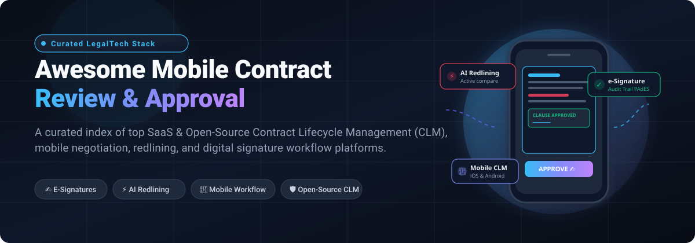

  

# Awesome Mobile Contract Review & Approval 

> A curated list of top **Mobile Contract Review and Approval** platforms, Contract Lifecycle Management (CLM) suites, and open-source alternatives for reviewing, redlining, and approving legal agreements from mobile devices (iOS & Android).
> 🌟 Star this repo if you find it useful! 🌟

---

## 🔍 Sector Overview & Market Dynamics

The global **Contract Lifecycle Management (CLM)** software market is valued at approximately **$2.5 billion to $3.3 billion** and is projected to expand past **$8 billion to $11 billion** over the next decade (growing at a compound annual growth rate of 12%–14%). The sector is currently **moderately fragmented**—with the top five enterprise vendors commanding roughly 30%–35% of overall market revenue, leaving significant opportunity for specialized point solutions, AI-assisted review tools, and open-source self-hosted implementations. However, strategic consolidation is steadily accelerating as major players acquire AI redlining and natural language processing startups to integrate mobile review pipelines into unified end-to-end contracting ecosystems.

---

## 📋 Table of Contents

- [Sector Overview & Market Dynamics](#-sector-overview--market-dynamics)
- [SaaS / Hosted Platforms](#-saas--hosted-platforms)
- [Open-Source Software](#-open-source-software)
- [Comprehensive Comparison Matrix](#-comprehensive-comparison-matrix)
- [Key Evaluation Criteria for Mobile Contract Review](#-key-evaluation-criteria-for-mobile-contract-review)
- [Contributing](#-contributing)
- [License](#-license)

---

## 🟦 SaaS / Hosted Platforms

Commercial, cloud-hosted mobile contract review, redlining, and digital approval platforms.

*The table is sorted in descending order by company scale (market capitalization or private enterprise valuation).*

| Company & Platform | Scale (Valuation / Market Cap) | Starting Price (Paid Tier) | Free Tier / Trial Limits | Key Capabilities & Mobile Review Focus |
| :--- | :--- | :--- | :--- | :--- |
| **Adobe Acrobat Sign** | ~$94.6 Billion (Market Cap, NASDAQ: ADBE) | **$12.99 / user / month** (Acrobat Standard, annual commitment) | **30-day free trial**; permanent free tier allows signing and recipient viewing only (no document sending) | Native mobile apps for iOS and Android; provides mobile Reading Mode, audit trails, Certified PDFs, and offline e-signing with automatic background sync once back online. |
| **Docusign Mobile** | ~$15.0 Billion (Market Cap, NASDAQ: DOCU) | **$10.00 / month** (Personal plan, billed annually) | **30-day free trial**; permanent free plan limited to a **lifetime total of 3 document sending requests** (unlimited free signing) | Redesigned iOS/Android apps with camera document capture, field drag-and-drop, real-time push alerts, and agreement status tracking dashboards. |
| **Coupa Mobile Approvals** | ~$8.0 Billion (Enterprise Acquisition by Thoma Bravo) | **~$20,000 / year** (Starting mid-market deployment quote) | **No public free tier or self-serve trial** (Demo upon request only) | Mobile procurement & contract spend approvals; centralized contract repository, preferred supplier search, and mobile workflow routing. |
| **Ironclad** | $3.2 Billion (Valuation, Series E) | **~$15,000 / year** (Starting mid-market annual contract) | **No public free tier or self-serve trial** (Custom demo & scoping only) | AI-powered digital contracting with responsive mobile signing experiences, launch forms, version approval notifications, and @mention collaboration feeds. |
| **Conga Contracts Mobile** | ~$2.0 Billion (Enterprise Valuation via Thoma Bravo / Apttus) | **$35.00 / user / month** (Starting baseline enterprise module) | **No public free tier or self-serve trial** (Sales assisted evaluation only) | Slim mobile-optimized web interface across iOS and Android for approving or declining workflow gateway steps, viewing repository documents, and event tracking. |
| **SignNow Mobile** | ~$1.25 Billion (Parent airSlate Series C Valuation) | **$8.00 / user / month** (Business tier, billed annually) | **7-day free trial** with full platform capabilities; no permanent free sending tier | Mobile e-signing with offline support, PDF/Word document completion, team document sharing, and Kiosk Mode for in-person signature capture. |
| **PandaDoc Mobile** | $1.0 Billion (Valuation, Series C Unicorn) | **$19.00 / seat / month** (Starter plan, billed annually) | **14-day free trial**; permanent Free eSign tier limited to **5 document sends per month** and up to 5 stored templates | Native mobile app allowing document creation, proposal sending, in-app approval execution, comment tracking, and real-time open/view alerts. |

---

## 🟩 Open-Source Software

Self-hosted, developer-friendly, and community-driven mobile contract review, redlining, and digital signing software.

*Sorted in descending order by GitHub stargazers count.*

| Project | Stars | Stack | License | Mobile Capabilities & Highlights |
| :--- | :--- | :--- | :--- | :--- |
| [**DocuSeal**](https://github.com/docusealco/docuseal) |  | Ruby, PostgreSQL | AGPL-3.0 | Modern open-source DocuSign alternative featuring a mobile-responsive interface and a **native iOS mobile app**. Offers 12 field types, multi-signer workflows, PDF creation, and webhook integrations. |
| [**Documenso**](https://github.com/documenso/documenso) |  | Next.js, TypeScript, PostgreSQL | AGPL-3.0 | Modern, open digital signing infrastructure. Highly responsive web interface optimized for touchscreen document inspection, signing flows, and multi-party cryptographic sealing. |
| [**Signature Pad**](https://github.com/szimek/signature_pad) |  | JavaScript, HTML5 Canvas | MIT | Smooth, responsive HTML5 canvas signature capture library tailored for mobile touch devices and styluses; widely integrated into custom mobile contract approval web apps. |
| [**OpenSign**](https://github.com/OpenSignLabs/OpenSign) |  | Node.js, React, MongoDB | AGPL-3.0 | Open-source e-signature platform providing REST APIs, self-hosted deployment, mobile-compatible document review, and multi-user signing workflows. |
| [**OnlyOffice Document Server**](https://github.com/ONLYOFFICE/DocumentServer) |  | C++, JavaScript, Native Mobile | AGPL-3.0 | Native iOS and Android mobile applications supporting **Track Changes, document redlining, and review modes**. Enables clause editing and real-time collaborative document review. |
| [**draftLegal**](https://github.com/AniketTati/draft-legal) |  | TypeScript, Python, Docker | AGPL-3.0 | Self-hosted, AI-native contract lifecycle management platform positioned as an open alternative to Ironclad and Harvey. Features agentic redline suggestions, mobile browser review, and safe rollback cards. |
| [**Click2Approve**](https://github.com/luarvic/click2approve) |  | .NET Core, SQL Server, Docker | MIT | Permissive MIT-licensed document approval workflow engine supporting sequential/parallel multi-step approval routing, audit logging, and responsive mobile review screens. |
| [**OpenCLM**](https://github.com/bytecrunch-io/openclm) |  | TypeScript, PostgreSQL, Docker | AGPL-3.0 | Open-source CLM platform focused on contract repositories, clause libraries, role-based approval routing, sealed PDF generation, and mobile-friendly web administration. |

---

## 📊 Comprehensive Comparison Matrix

| Software Platform | Type / License | Mobile Experience | In-App Redline / Review | Digital Signing | Self-Hosted / On-Prem | Best For |
| :--- | :--- | :--- | :--- | :--- | :--- | :--- |
| **Adobe Acrobat Sign** | Proprietary SaaS | Native iOS / Android | Limited (Reading Mode) | ✅ Yes (Offline sync) | ❌ Cloud Only | Global enterprise standard for offline & compliant mobile signature |
| **Docusign Mobile** | Proprietary SaaS | Native iOS / Android | Limited (Status tracking) | ✅ Yes | ❌ Cloud Only | Ubiquitous mobile e-signatures and agreement tracking |
| **Coupa Approvals** | Proprietary SaaS | Native iOS / Android | ❌ (Workflow approval) | ✅ Procurement sign | ❌ Cloud Only | Enterprise procurement review and contract financial approvals |
| **Ironclad** | Proprietary SaaS | Mobile Web / Responsive | ❌ (Desktop redlining) | ✅ Mobile signing | ❌ Cloud Only | Large enterprise intake, collaboration, and mobile execution |
| **Conga Contracts** | Proprietary SaaS | Responsive Slim Web | ❌ (Gateway approval) | ✅ Conga Sign | ❌ Cloud Only | Salesforce-centric enterprise CLM with mobile approval steps |
| **SignNow Mobile** | Proprietary SaaS | Native iOS / Android | ❌ (Form fill only) | ✅ Yes (Kiosk mode) | ❌ Cloud Only | Budget-conscious teams and on-site mobile kiosk signing |
| **PandaDoc Mobile** | Proprietary SaaS | Native iOS / Android | Limited (Comment/Approve)| ✅ Yes | ❌ Cloud Only | Sales quote proposals and rapid mobile executive sign-offs |
| **DocuSeal** | Open-Source (AGPL-3.0)| Native iOS & Responsive Web| ❌ (Signing flow) | ✅ Yes | ✅ Yes (Docker) | Self-hosted mobile-first e-signature workflows |
| **Documenso** | Open-Source (AGPL-3.0)| Mobile Web / Responsive | ❌ (Field signing) | ✅ Cryptographic | ✅ Yes (Docker) | Next.js-based self-hosted digital signing infrastructure |
| **Signature Pad** | Open-Source (MIT) | Touchscreen Canvas Library | ❌ (Canvas component) | ✅ Signature drawing | ✅ Client-side library| Custom mobile contract web and hybrid apps |
| **OpenSign** | Open-Source (AGPL-3.0)| Mobile Web / Responsive | ❌ (Field signing) | ✅ Yes | ✅ Yes (Docker) | Free & self-hosted REST API-first signature automation |
| **OnlyOffice** | Open-Source (AGPL-3.0)| Native iOS / Android | ✅ Full Track Changes | ❌ (Doc editing) | ✅ Yes | Detailed mobile clause redlining, markup, and revision comparison |
| **draftLegal** | Open-Source (AGPL-3.0)| Mobile Web / Responsive | ✅ AI Agent Redlining | ✅ Integrated | ✅ Yes (Docker) | Private, self-hosted AI-driven contract redline and review |
| **Click2Approve** | Open-Source (MIT) | Mobile Web / Responsive | ❌ (Document approval) | ✅ Basic approval | ✅ Yes (.NET) | Flexible, permissive document approval orchestration |
| **OpenCLM** | Open-Source (AGPL-3.0)| Mobile Web / Responsive | ✅ Collaborative review| ✅ Sealed PDF | ✅ Yes (Docker) | Self-hosted full contract lifecycle management |

---

## 💡 Key Evaluation Criteria for Mobile Contract Review

When evaluating platforms for mobile contract review and sign-off, legal and procurement teams should consider:

1. **Touchscreen Redlining vs. Gate Approval:** Does your workflow require deep on-the-go clause editing (such as OnlyOffice or draftLegal), or simply rapid executive one-touch approval (like Coupa or Conga)?
2. **Offline Readiness:** Field personnel and traveling executives often require offline contract review and signature capture with automatic synchronization (e.g., Adobe Acrobat Sign or SignNow).
3. **Audit Trails & Security Compliance:** Ensure cryptographic authenticity (PAdES, ESIGN, UETA, and eIDAS compliance) and tamper-evident sealed PDFs.
4. **Data Sovereignty & Self-Hosting:** Regulated sectors often mandate that contracts never leave on-premise infrastructure; self-hosted open-source options like DocuSeal, draftLegal, and OpenCLM address this requirement.

---

## 🤝 Contributing

Contributions are warmly welcome! If you know of an active SaaS platform or open-source repository focusing on mobile contract review, redlining, or approval:

1. Fork this repository.
2. Create a branch: `git checkout -b feature/new-tool`.
3. Add the project with details, pricing/stars, and mobile capabilities.
4. Open a Pull Request.

---

## 📄 License

This repository is distributed under the [CC0 1.0 Universal (Public Domain)](LICENSE) license. Listed trademarks and software packages belong to their respective owners.